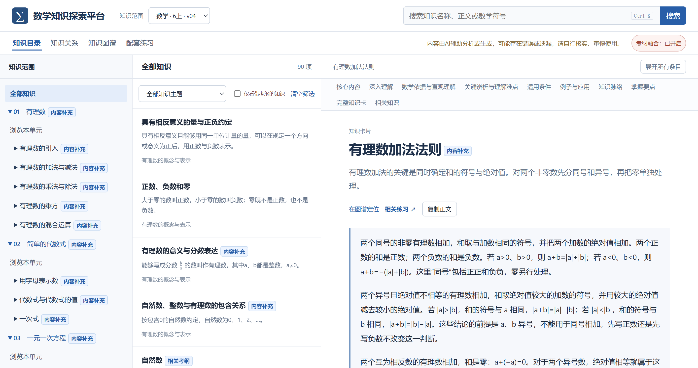
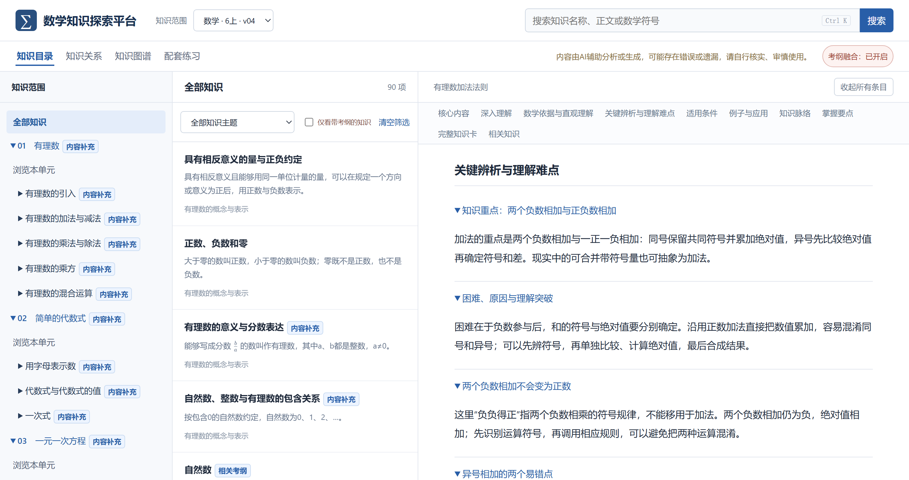
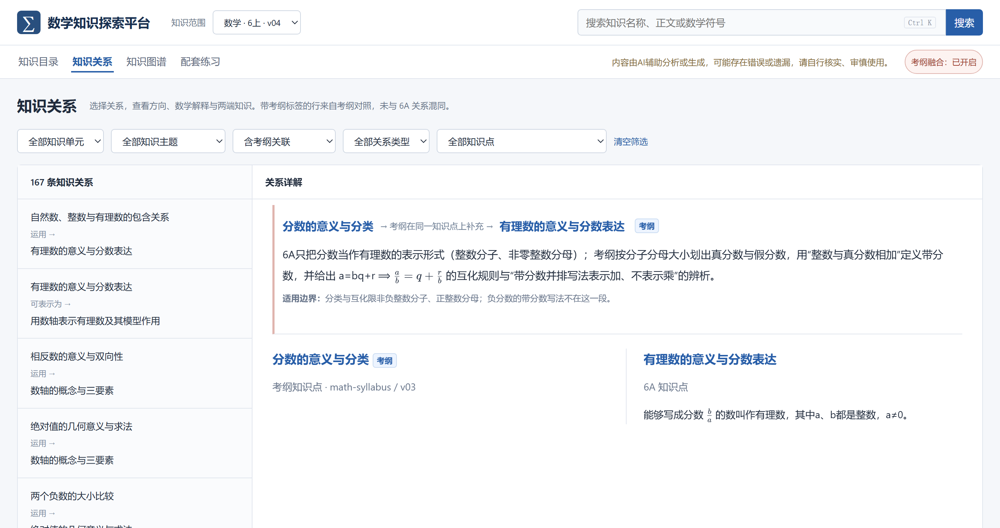
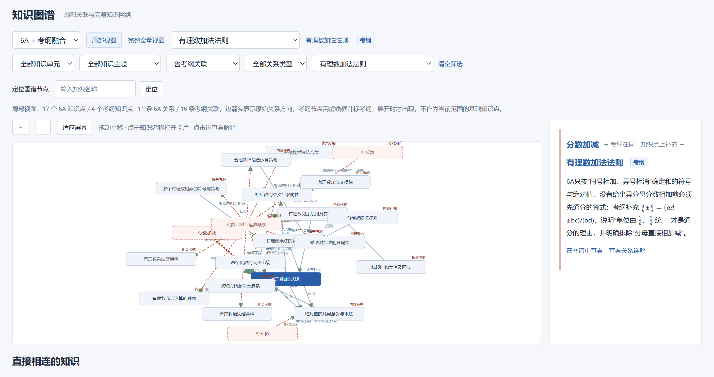
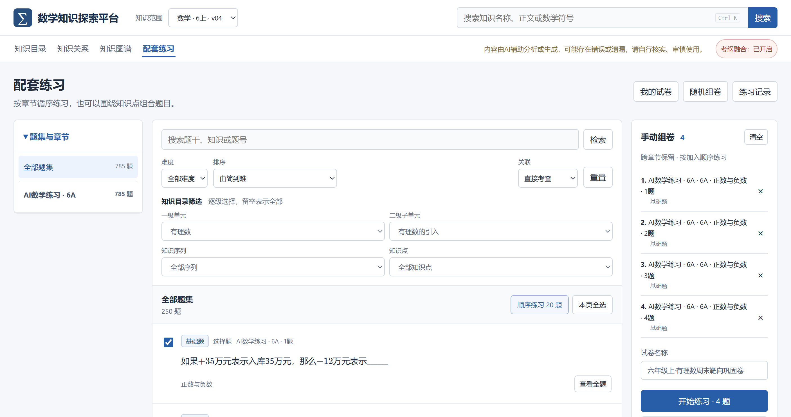
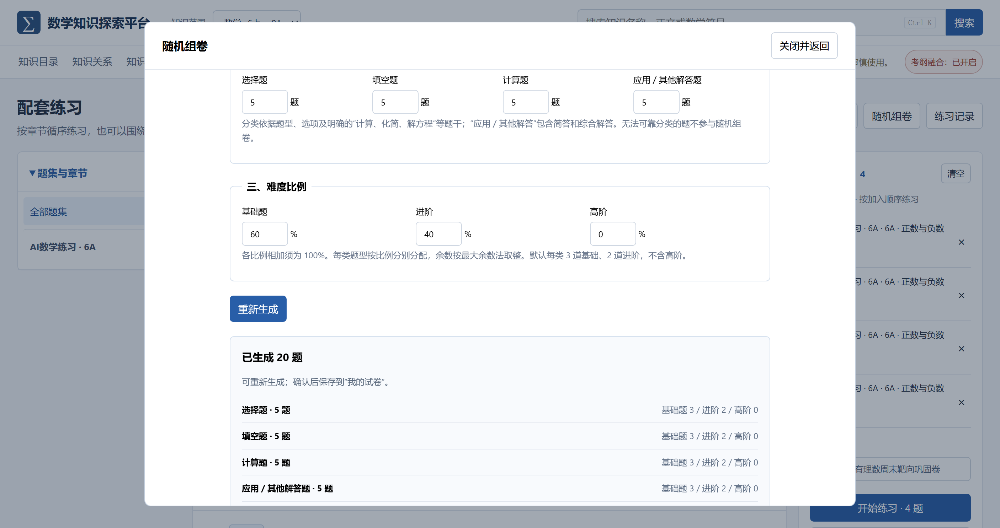
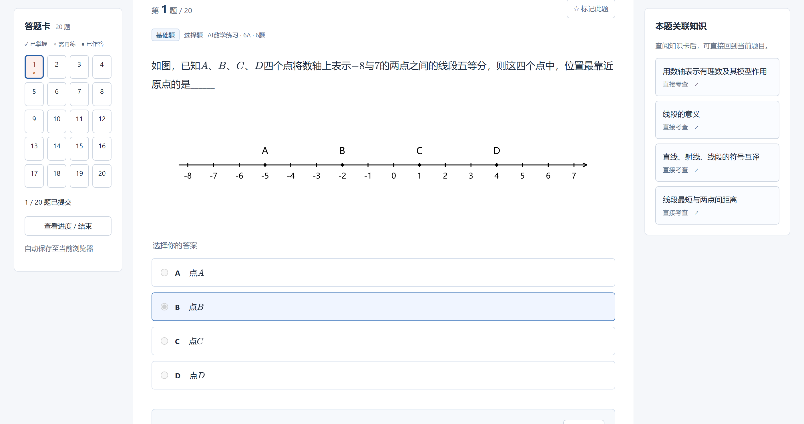

# 数学知识探索平台 · Community 0.3.1

[在线预览](https://www.heartlifes.com)

本项目是一个面向上海五四学制初中阶段（六年级起点）的本地化数学知识检索、考纲对照与配套练习系统。系统后端基于 Python 3.10+ 标准库实现，前端内置离线版 KaTeX 数学公式渲染组件，无需安装第三方运行依赖，可在本地浏览器中离线运行。

当前发行版本（`community 0.3.1`）收录了**六年级第一学期（6A）数学**的知识图谱、考纲融合映射及原创配套练习题集。后续版本将按照上海五四学制逐步补充后续学期（6B、7A–9B）及其他学科内容，并持续更新练习资源与功能模块。

## 一、内容范围与数据构成

### 1. 学制与年级范围

* **适用学制**：上海五四教育制度（小学五年、初中四年，六年级为初中起始年级）。
* **当前范围**：六年级第一学期（6A）数学，涵盖四个一级单元：
  1. `有理数`（有理数的引入、加法与减法、乘法与除法、乘方、混合运算）
  2. `简单的代数式`（用字母表示数、代数式与代数式的值、一次式）
  3. `一元一次方程`（方程与列方程、一元一次方程及其解法、一元一次方程的应用）
  4. `线段与角`（线段、角）
* **目录层级**：4 个一级单元（`groups`）→ 13 个二级子单元（`subgroups`）→ 37 个知识序列（`sequences`），并按数学认知结构划分为 9 个知识主题（`topics`）。

### 2. 数据集统计（`math-g6a@v04` + `g6a-set1`）

| 数据模块 | 核心指标与数量 | 内容说明 |
| :--- | :--- | :--- |
| **6A 知识库** | 90 个知识点、1,301 个知识条目、433 条掌握要点、29 篇关联背景 | 围绕六年级上学期数学课程内容构建。每个知识点拆解为定义与核心规则（`CORE_RULE` / `DEFINITION`）、可执行算法步骤（`ALGORITHM`）、算理依据与直观理解（`RATIONALE` / `INTUITION`）、知识重点（`KEY_IDEA`，217 条）、理解难点与突破（`CONCEPT_DIFFICULTY`，133 条）、常见易错点辨析（`MISCONCEPTION`）、适用条件与边界（`SCOPE_LIMIT`，165 条）以及附带核验标准的掌握要点（`MASTERY`）。 |
| **考纲融合数据** | 49 个融合考纲知识点、106 条跨库映射记录 | 对照初中数学学科课程要求整理。其中 41 个 6A 知识点包含同点内容补充（`INLINE_EXTENSION`，共 55 条，补充算理说明、公式或定义口径差异），68 个 6A 知识点包含相关考纲关联（`RELATED_ONLY`，共 51 条）。 |
| **知识逻辑关系** | 61 条 6A 内部关系、106 条跨考纲关联 | 包含 `运用 (USES)`、`依据 (JUSTIFIED_BY)`、`类比于 (ANALOGOUS_TO)`、`属于 (IS_A)`、`对比于 (CONTRASTS_WITH)`、`是其组成部分 (PART_OF)`、`需要 (REQUIRES)`、`可表示为 (REPRESENTED_BY)`、`可转化为 (TRANSFORMS_TO)` 共 9 类语义关系。 |
| **配套练习题集** | 785 道结构化题目、159 张配图、2,458 条题-点关联 | 围绕知识图谱节点与考纲要求由 AI 生成的原创配套练习题及矢量配图。全部题目按 `基础题`、`进阶`、`高阶` 标注难度，按 `选择题`、`填空题`、`计算题`、`应用／其他解答题` 划分题型，并与知识库建立 `直接考查`、`前置应用`、`拓展应用` 三类关联。 |

### 3. 内容状态说明

* **人工复核状态**：包内全部知识拆解、考纲映射与练习题解析均由 AI 辅助分析或生成，当前人工审核状态为 `PENDING`。技术契约校验不代替人工审核，内容可能存在错误或遗漏，请使用者自行核实、审慎使用。已知的 14 项题目与解析自检存疑记录详见根目录 `KNOWN_ISSUES.md`。

## 二、核心功能模块

### 1. 知识目录与结构化知识卡片（`#view=catalog`）

* **三栏式浏览**：左侧按单元、子单元、知识序列与知识主题树状导航；中间展示当前筛选范围内的知识点列表，支持关键词与数学符号全局检索（快捷键 `Ctrl + K`）；右侧展示完整知识卡片。
* **结构化分层阅读**：知识卡片按“核心内容 → 深入理解 → 数学依据与直观理解 → 关键辨析与理解难点（含知识重点与易错辨析） → 适用条件 → 例子与应用 → 知识脉络 → 掌握要点”组织，支持一键展开或收起全部条目、复制正文、定位至知识图谱或跳转至关联练习题。

### 2. 考纲融合视图切换（Syllabus Fusion）

* **开关控制**：顶部导航栏提供「考纲融合：已开启 / 已关闭」切换按钮。关闭后界面仅展示纯粹的 6A 课程范围目录、知识卡、关系与图谱；开启后自动加载考纲融合投影数据。
* **口径区分**：融入当前知识卡的考纲条目统一标注 `考纲补充` 徽章，并附带口径差异说明（`differenceSummary`）与适用边界提示；跨年级或独立考纲主题在目录与卡片中单独标识，区分初中阶段考纲口径与六年级上学期现行教学要求。

### 3. 知识关系并排对照（`#view=relations`）

* **多维筛选**：支持按关系来源（含考纲关联 / 只看 6A 内部关系 / 只看考纲关联）、知识单元、知识主题、关系类型及具体知识点过滤。
* **双栏对照阅读**：选中任一关系后，右侧面板上方显示该关系的数学逻辑说明与方向，下方以左右分栏形式并排展示起点与终点两个知识点的核心规则与摘要。

### 4. 交互式知识图谱（`#view=graph`）

* **三种图谱模式**：支持切换 `6A 基础`、`6A + 考纲融合`、`考纲关联子图` 三种模式。
* **局部与全局视图**：支持以指定知识点为中心展开 1 至 3 跳局部关联网络，或切换至完整全量视图。画布中 6A 节点以实线框绘制，考纲节点以虚线框绘制；支持缩放、平移、节点搜索定位，点击节点可打开对应知识卡，点击连线可在右侧查看关系解释。

### 5. 配套练习、组卷与打印（`#view=practice`）

* **多维检索与靶向筛选**：支持按章节浏览，或通过「一级单元 → 二级子单元 → 知识序列 → 知识点」四级目录筛选题目；支持按难度（基础题 / 进阶 / 高阶）、难度排序（由简到难 / 由难到简）及关联角色（仅看直接考查 / 含前置与拓展）过滤。
* **组卷方式**：
  * **顺序练习**：按当前筛选范围或章节顺序逐题练习，自动跳过已提交题目或继续未完成会话。
  * **手动选题篮**：支持跨章节勾选题目（单次最多 100 题），命名保存至本地「我的试卷」或直接开始练习、打印。
  * **随机组卷**：选择一级单元或二级子单元范围，分别设置选择题、填空题、计算题、应用／其他解答题的题量（总题数最多 100 题），并设置基础、进阶、高阶三档难度百分比（总和为 100%，按最大余数法分配各题型难度配额，仅使用 `DIRECT_ASSESSMENT` 直接考查关联抽题）。
* **在线作答与错题重练（`#view=exercise`）**：
  * 左侧提供答题卡进度矩阵，标记已掌握、需再练、已作答与待复查题目。
  * 单选题提交后自动核对标准选项；填空题与解答题展示参考答案、分项答案与解题解析，由使用者对照完成「已掌握 / 还需再练」自评。
  * 答题界面右侧列出「本题关联知识」，点击即可在当前页弹出对应知识卡片浮层查阅算理，关闭浮层后直接回到当前题目。
  * 练习结束后统计各状态题量，支持将本次标记为「需再练」的错题一键重新组卷练习。
* **试卷排版与打印（`#view=print`）**：
  * 支持自定义试卷标题（自动生成姓名、日期栏），提供 `标准`、`加大`、`紧凑` 三档答题留白空间调节，可选是否附加独立参考答案页。系统在确认公式字体与题目配图全部加载就绪后调用浏览器打印接口，支持直接打印或导出为 PDF。

## 三、系统界面截图

### 图 1：知识目录与考纲融合三栏界面




<details>
<summary>截图路由与视图说明（<code>01-knowledge-catalog-workspace.png</code>）</summary>

* **访问路径**：`http://127.0.0.1:8782/#view=catalog&dataset=math-g6a&version=v04&point=MATH2-G6A-K000001`
* **界面内容**：左侧为单元与子单元目录树（标注 `内容补充` / `相关考纲`），中间为 90 个知识点列表，右侧为《有理数加法法则》知识卡片核心内容。

</details>

### 图 2：知识卡片条目展开（重点、理解难点与易错点辨析）




<details>
<summary>截图路由与视图说明（<code>02-knowledge-card-deep-dive.png</code>）</summary>

* **访问路径**：`http://127.0.0.1:8782/#view=catalog&dataset=math-g6a&version=v04&point=MATH2-G6A-K000001`
* **界面内容**：点击右侧「展开所有条目」并滚动至「关键辨析与理解难点」章节，展示知识重点、理解难点突破以及“两个负数相加不会变为正数”“异号相加的两个易错点”等辨析条目。

</details>

### 图 3：知识关系双栏对照视图




<details>
<summary>截图路由与视图说明（<code>03-knowledge-relations-comparison.png</code>）</summary>

* **访问路径**：`http://127.0.0.1:8782/#view=relations&dataset=math-g6a&version=v04`
* **界面内容**：左侧展示知识关系列表，右侧上方展示所选关系的数学解释与适用边界，下方左右并排展示关联两端的知识点内容。

</details>

### 图 4：交互式知识图谱（6A + 考纲融合模式）




<details>
<summary>截图路由与视图说明（<code>04-interactive-knowledge-graph.png</code>）</summary>

* **访问路径**：`http://127.0.0.1:8782/#view=graph&dataset=math-g6a&version=v04&gmode=fused&mode=local&depth=2&point=MATH2-G6A-K000001`
* **界面内容**：左侧 SVG 图谱展示以《有理数加法法则》为中心的 2 跳局部网络（实线框为 6A 节点，虚线框为考纲节点），右侧展示选中连线的关系说明。

</details>

### 图 5：配套练习题集筛选与手动选题篮




<details>
<summary>截图路由与视图说明（<code>05-practice-question-bank.png</code>）</summary>

* **访问路径**：`http://127.0.0.1:8782/#view=practice&dataset=math-g6a&version=v04&kgroup=UNIT-1&ksub=SUB-01`
* **界面内容**：展示左侧题集章节目录、中间四级知识目录筛选器、题目列表及右侧「手动组卷」选题篮。

</details>

### 图 6：随机组卷配置与题目预览




<details>
<summary>截图路由与视图说明（<code>06-random-paper-builder.png</code>）</summary>

* **访问路径**：`http://127.0.0.1:8782/#view=practice&dataset=math-g6a&version=v04`（打开「随机组卷」弹窗）
* **界面内容**：展示题型数量配置、基础/进阶/高阶难度百分比设置及按条件生成的 20 道题目分布预览。

</details>

### 图 7：在线作答核对与 A4 试卷打印排版预览




<details>
<summary>截图路由与视图说明（<code>07-online-exercise-and-print.png</code>）</summary>

* **界面内容**：左图为在线作答视图（`#view=exercise`），展示答题卡、题目作答、自动核对结果、参考答案解析及右侧「本题关联知识」入口；右图为打印排版预览视图（`#view=print`），展示试卷标题、答题空间调节与独立答案页选项。

</details>

## 四、运行环境与启动方法

### 1. 环境要求

* **Python 版本**：Python 3.10 或更高版本（仅使用 Python 标准库，无需安装任何第三方包）。
* **浏览器**：支持现代 Web 标准（ES2020+、`<dialog>`、`localStorage`）的桌面或移动浏览器。

### 2. 启动步骤

* **Windows 系统**：
  双击根目录下的 `start.bat`，然后在浏览器中访问 `http://127.0.0.1:8782`。
* **macOS / Linux 系统**：
  双击 `start.command` 或在终端执行 `./start.sh`，也可直接运行以下命令行：

```bash
python3 apps/knowledge_review/portal/server.py --state-dir .local --port 8782
```

### 3. 命令行参数

| 参数 | 默认值 | 说明 |
| :--- | :--- | :--- |
| `--port <端口号>` | `8782` | 指定本地 HTTP 服务监听端口（仅允许本机回环地址访问） |
| `--state-dir <路径>` | `.local` | 指定本地运行状态目录；升级版本时可保留独立运行数据 |
| `--no-fusion` | 默认启用融合 | 禁用考纲融合数据，仅展示 6A 基础知识视图 |
| `--public` | 默认启用预览 | 仅显示已标记为正式发布的数据（注：当前候选练习题集需在默认预览模式下访问） |

> **本地数据存储说明**：开源社区版不包含后台管理模块。用户的选题篮、已保存试卷、作答草稿与练习历史记录均保存在当前浏览器的 `localStorage` 中，不跨设备同步；回滚版本时可直接启动旧发行包，不混用内容文件。

## 五、目录结构说明

| 路径 | 说明 |
| :--- | :--- |
| `start.bat` / `start.sh` / `start.command` | Windows、Linux 与 macOS 本地启动脚本 |
| `release-manifest.json` | 发行版清单文件，记录数据集配置、题集映射与核心文件 SHA-256 摘要 |
| `SHA256SUMS` | 仓库文件 SHA-256 校验值汇总表 |
| `CHANGELOG.md` | 版本变更记录与数据统计快照 |
| `KNOWN_ISSUES.md` | 已知数学内容与解析自检问题记录 |
| `LICENSE` | 个人学习与非商业使用许可协议文本 |
| `CONTRIBUTING.md` | 内容勘误与问题反馈说明 |
| `apps/knowledge_review/portal/server.py` | 本地 HTTP 服务端入口与 API 路由实现 |
| `apps/knowledge_review/portal/catalog.py` | 知识图谱数据结构与引用完整性校验模块 |
| `apps/knowledge_review/portal/fusion.py` | 6A 知识图谱与考纲数据跨库融合只读投影模块 |
| `apps/knowledge_review/portal/practice.py` | 题集加载、难度配比、随机组卷与配图资源只读适配模块 |
| `apps/knowledge_review/portal/resources.py` | 发行版只读资源与 SHA-256 完整性校验加载器 |
| `apps/knowledge_review/portal/web/` | 前端静态资源（`index.html`、`app.js`、`practice.js`、`knowledge-math.js`、样式表及内置 `vendor/katex/`） |
| `content/knowledge_graph/1.数学/6a/` | 6A 数学公开知识图谱（`math_g6a_public_v04.json`）、考纲融合快照（`fusion_release_v01.json`）与题-点关联表（`g6a_question_knowledge_v01.json`） |
| `content/question_bank/ai_generated/1.数学/6a/set_g6a_01/` | 6A 数学 AI 生成练习题集 JSON（`questions.json`）、难度标注文件（`difficulty.json`）及 159 张题目配图（PNG/SVG） |
| `docs/screenshots/` | 系统各功能模块界面截图 |

## 六、后续更新计划

1. **学年与学科扩展**：当前版本仅包含上海五四学制六年级上学期（6A）数学。后续将按五四学制教学进度陆续整理 6B、7A、7B、8A、8B、9A、9B 数学及其他学科内容（前端与数据结构已预留跨年级、多知识集切换支持）。
2. **题集与练习功能迭代**：后续更新将继续修订 `KNOWN_ISSUES.md` 中记录的存疑题目，并逐步扩充更多 AI 原创练习资源与配套练习方式。

## 七、使用许可说明（License）

1. **个人非商业使用开源**：
   本项目源代码、前端界面、知识图谱数据、考纲融合数据及 AI 生成练习题集仅面向**个人学习、家庭学业辅导与非商业教学研究**免费开放（完整条款见根目录 `LICENSE` 文件及 CC BY-NC-SA 4.0 协议）。
2. **禁止商业用途**：
   未经项目负责人书面许可，**严禁任何商业用途**，包括但不限于：在任何电商或社交平台售卖本程序、数据或导出的练习卷；在商业教育培训机构、盈利性工作室或商业产品中部署、集成或分发本项目；将本项目作为付费课程或商业活动的赠品。
3. **第三方组件许可**：
   内置数学公式渲染库 KaTeX 遵循 MIT 许可协议，其许可文件位于 `apps/knowledge_review/portal/web/vendor/katex/LICENSE`。
